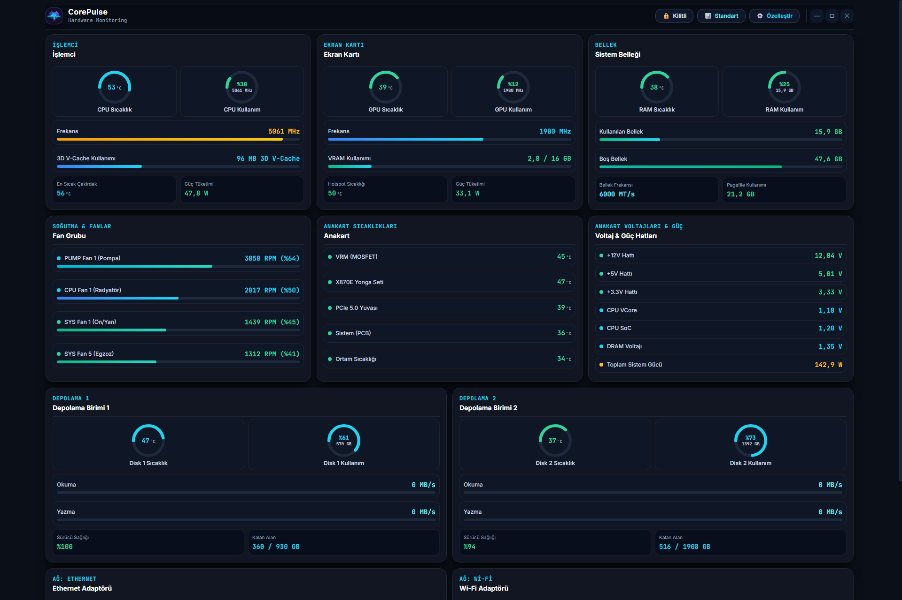
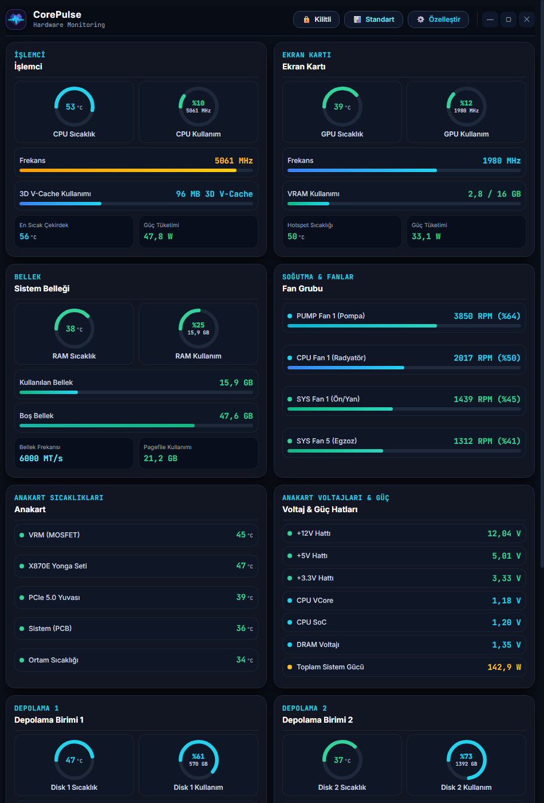
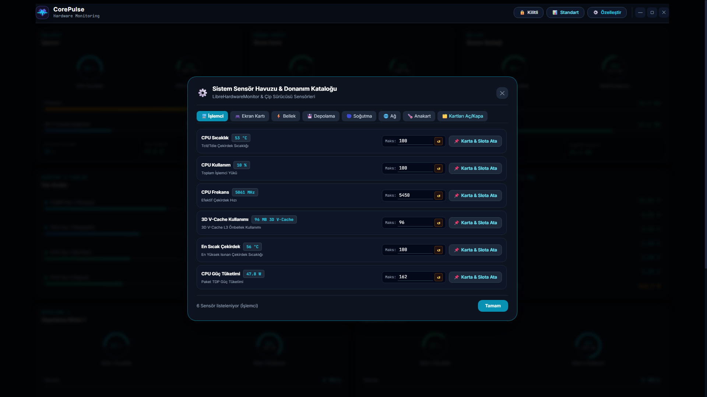

# ⚡ CorePulse - Modern Donanım & Canlı Telemetri İzleme Merkezi

[](https://github.com/kadirersoy/LuckyStrike-CorePulse/releases)
[](https://github.com/kadirersoy/LuckyStrike-CorePulse)
[](https://dotnet.microsoft.com/)
[](https://developer.microsoft.com/en-us/microsoft-edge/webview2/)
[](LICENSE)

MSI Center, ASUS Armoury Crate veya Gigabyte Control Center gibi şişkin (bloatware) ve üretici bağımlı yazılımlara modern, hafif, yüksek performanslı ve modüler açık kaynak bir alternatiftir.

---

## 📸 Ekran Görüntüleri

### 🖥️ 1. Standart & Geniş Ekran Kontrol Paneli
Donanımınızdaki tüm aktif sensörleri (CPU, GPU, RAM, AIO/Fanlar, NVMe Diskler, Ağ, Anakart sıcaklık ve voltajları) gerçek zamanlı izleyin.

<p align="center">
  
</p>

---

### 📱 2. Minimal / Yan Panel Görünümü
Pencere daraltıldığında veya minimal moda geçildiğinde akıllı sütun düzenine geçer; ekranınızda az yer kaplayan şık bir dikey HUD sunar.

<p align="center">
  
</p>

---

### 🪟 3. Pop-out Mini HUD (İkincil Ekran & Oyun İçi Widget)
Seçtiğiniz kritik metrikleri bağımsız, kompakt, çerçevesiz bir mini pencereye (Pop-out) dönüştürerek ikincil monitörünüze veya mini ekranınıza yerleştirebilirsiniz.

<p align="center">
  
</p>

---

### ⚙️ 4. Sensör Kataloğu & Özel Metrik Atama
Sisteminizde keşfedilen tüm sensör havuzunu görüntüleyip kartlardaki slotlara istediğiniz metriği tek tıkla atayabilirsiniz.

<p align="center">
  
</p>

---

## 📥 İndirme & Kurulum

En son kararlı sürümü projenin **[Releases](https://github.com/kadirersoy/LuckyStrike-CorePulse/releases/tag/v1.0.1)** sayfasından indirebilirsiniz:

| Paket Türü | Dosya | Açıklama |
| :--- | :--- | :--- |
| **Windows Kurulum Paketi** | `CorePulse_v1.0.1_Setup.msi` | Başlat menüsü ve masaüstü kısayolları ile tam sistem kurulumu. |
| **Taşınabilir Sürüm (Portable)** | `CorePulse_v1.0.1_Portable.zip` | Kurulum gerektirmeden ZIP'ten çıkarıp doğrudan çalıştırılabilir. |

> [!NOTE]
> **Yönetici Yetkisi:** Anakart üzerindeki fan devirleri (RPM), pompa hızı ve VRM/Hotspot sıcaklıkları gibi donanım düzeyindeki (Ring 0) sensörlerin okunabilmesi için uygulamanın **Yönetici Olarak Çalıştır** (Run as Administrator) yetkisiyle açılması önerilir.

---

## 🎯 Temel Özellikler

* **Evrensel Donanım Keşfi (Ring 0):**
  * Intel, AMD, NVIDIA, MSI, ASUS, Gigabyte ayrımı olmaksızın tüm aktif donanımları otomatik olarak algılar.
  * CPU & GPU sıcaklıkları, hotspot, çekirdek frekansları, VRAM kullanımı ve güç tüketimleri (Watt).
  * Anakart sıcaklıkları (VRM, Chipset, PCIe) ve voltaj hatları (+12V, +5V, +3.3V, VCore, SoC, DRAM).
  * AIO pompa devri, radyatör ve kasa fan devirleri (RPM).
  * NVMe / SSD disk sağlık durumu, kalan boş alan ve okuma/yazma hızları.

* **Canlı Win32 Düşük Seviye Metrikler:**
  * Win32 `GetSystemTimes` ile en hassas CPU yükü hesaplaması.
  * Win32 `GlobalMemoryStatusEx` ile anlık RAM doluluğu ve boş bellek (GB) takibi.
  * `NetworkInterface` üzerinden Ethernet ve Wi-Fi için anlık indirme/yükleme hızları ve DNS ping gecikmesi.

* **Sistem Tepsisi (Tray) & Akıllı Arka Plan Yönetimi:**
  * Simge durumuna küçültüldüğünde Windows görev çubuğuna iner.
  * Kapatıldığında arka planda sistem tepsisinde (tray) sessizce çalışmaya devam eder.
  * Tepsi simgesine sağ tıklayarak tek tıkla **Standby Bellek Temizleme** yapılabilir.

* **Duyarlı (Responsive) Tasarım:**
  * Geniş ekranda 4 sütunlu zengin kontrol paneli, dar ekranda 1-2 sütunlu kompakt HUD.
  * Sabit başlık çubuğu (Sticky Header) sayesinde kaydırma esnasında üst kontroller her zaman erişilebilirdir.

---

## 📁 Proje Mimarisi

```
CorePulse/
├── docs/images/                  # Dokümantasyon ve README ekran görüntüleri
├── src/                          # Proje kaynak kodları (.NET 8 C# + WebView2)
│   ├── CorePulse.App/            # Modern UI, Pencere Yönetimi ve Sistem Tepsisi
│   └── CorePulse.Core/           # Win32 & LibreHardwareMonitor Canlı Telemetri Servisi
├── CorePulse.sln                 # Visual Studio / .NET Solution dosyası
└── README.md                     # Proje Tanıtım ve Dokümantasyonu
```

---

<p align="center">
  <sub>Modern, hafif ve tamamen özelleştirilebilir canlı donanım izleme merkezi.</sub>
</p>
