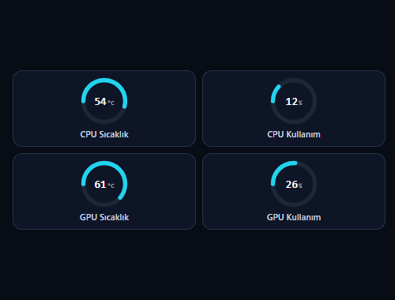

# ⚡ CorePulse - Modern Hardware & Live Telemetry Monitoring Center
### ⚡ Modern Donanım & Canlı Telemetri İzleme Merkezi

[](https://github.com/kadirersoy/LuckyStrike-CorePulse/releases)
[](https://github.com/kadirersoy/LuckyStrike-CorePulse)
[](https://dotnet.microsoft.com/)
[](https://developer.microsoft.com/en-us/microsoft-edge/webview2/)
[](LICENSE)

---

> 🇹🇷 **Türkçe:** MSI Center, ASUS Armoury Crate veya NZXT CAM gibi şişkin (bloatware) ve üretici bağımlı yazılımlara modern, hafif, yüksek performanslı ve modüler açık kaynak bir alternatif.  
> 🇬🇧 **English:** A modern, lightweight, high-performance, and modular open-source alternative to bloated and proprietary hardware utilities like MSI Center, ASUS Armoury Crate, or NZXT CAM.

---

> [!NOTE]
> ### 🌐 Dil Desteği Bildirimi / Language Support Notice
> 🇹🇷 **Uygulama Arayüzü:** CorePulse arayüzü şu anda Türkçe olarak sunulmaktadır. **İngilizce dil desteği çok yakında sonraki güncellemelerde eklenecektir.**  
> 🇬🇧 **Application Interface:** The CorePulse user interface is currently available in Turkish. **Full English language support will be added very soon in an upcoming release!**

---

## 📸 Ekran Görüntüleri / Screenshots

### 🖥️ 1. Standart & Geniş Ekran Kontrol Paneli / Standard & Widescreen Dashboard
* 🇹🇷 Donanımınızdaki tüm aktif sensörleri (CPU, GPU, RAM, AIO/Fanlar, NVMe Diskler, Ağ, Anakart sıcaklık ve voltajları) gerçek zamanlı izleyin.
* 🇬🇧 Monitor all active hardware sensors (CPU, GPU, RAM, AIO/Fans, NVMe Drives, Network, Motherboard temperatures and voltages) in real time.

<p align="center">
  
</p>

---

### 📱 2. Minimal / Yan Panel Görünümü / Minimal & Side Panel View
* 🇹🇷 Pencere daraltıldığında veya minimal moda geçildiğinde akıllı sütun düzenine geçer; ekranınızda az yer kaplayan şık bir dikey HUD sunar.
* 🇬🇧 Automatically switches to a smart column layout when resized or switched to minimal mode; provides a sleek, space-saving vertical HUD.

<p align="center">
  
</p>

---

### 🪟 3. Pop-out Mini HUD (İkincil Ekran & Oyun İçi Widget) / Pop-out Mini HUD
* 🇹🇷 Seçtiğiniz kritik metrikleri bağımsız, kompakt, çerçevesiz bir mini pencereye (Pop-out) dönüştürerek ikincil monitörünüze veya mini ekranınıza yerleştirebilirsiniz.
* 🇬🇧 Transform selected critical telemetry metrics into an independent, borderless mini window (Pop-out HUD) perfect for secondary monitors or mini displays.

<p align="center">
  
</p>

---

### ⚙️ 4. Sensör Kataloğu & Özel Metrik Atama / Sensor Catalog & Slot Assignment
* 🇹🇷 Sisteminizde keşfedilen tüm sensör havuzunu görüntüleyip kartlardaki slotlara istediğiniz metriği tek tıkla atayabilirsiniz.
* 🇬🇧 Inspect the full hardware sensor pool discovered on your system and assign any metric to card slots with a single click.

<p align="center">
  
</p>

---

## 📥 İndirme & Kurulum / Download & Installation

En son sürümü projenin **[GitHub Releases](https://github.com/kadirersoy/LuckyStrike-CorePulse/releases/latest)** sayfasından indirebilirsiniz:  
You can download the latest release from the official **[GitHub Releases](https://github.com/kadirersoy/LuckyStrike-CorePulse/releases/latest)** page:

| Paket / Package | Dosya / File | Açıklama / Description |
| :--- | :--- | :--- |
| **Windows Kurulum Paketi** / Setup MSI | `CorePulse_v1.0.1_Setup.msi` | Başlat menüsü ve masaüstü kısayolları ile tam sistem kurulumu.<br>Full installation with Start Menu and desktop shortcuts. |
| **Taşınabilir Sürüm** / Portable ZIP | `CorePulse_v1.0.1_Portable.zip` | Kurulum gerektirmeden ZIP'ten çıkarıp doğrudan çalıştırılabilir.<br>Self-contained standalone archive, runs without installation. |

> [!TIP]
> 🇹🇷 **Yönetici Yetkisi:** Anakart üzerindeki fan devirleri (RPM), pompa hızı ve VRM/Hotspot sıcaklıkları gibi donanım düzeyindeki (Ring 0) sensörlerin okunabilmesi için uygulamanın **Yönetici Olarak Çalıştır** (Run as Administrator) yetkisiyle açılması önerilir.  
> 🇬🇧 **Administrator Privileges:** To read low-level hardware sensors (Ring 0) such as motherboard fan RPMs, AIO pump speeds, and VRM/Hotspot temperatures, running CorePulse as **Administrator** is recommended.

---

## 🎯 Temel Özellikler / Key Features

### 🇹🇷 Türkçe
* **Evrensel Donanım Keşfi (Ring 0):**
  * Intel, AMD, NVIDIA, MSI, ASUS, Gigabyte ayrımı olmaksızın tüm aktif donanımları otomatik olarak algılar.
  * CPU & GPU sıcaklıkları, hotspot, çekirdek frekansları, VRAM kullanımı ve güç tüketimleri (Watt).
  * Anakart sıcaklıkları (VRM, Chipset, PCIe) ve voltaj hatları (+12V, +5V, +3.3V, VCore, SoC, DRAM).
  * AIO pompa devri, radyatör ve kasa fan devirleri (RPM).
  * NVMe / SSD disk sağlık durumu, kalan boş alan ve okuma/yazma hızları.
* **Canlı Win32 Düşük Seviye Metrikler:**
  * Win32 `GetSystemTimes` ile mikro saniye hassasiyetinde CPU yükü hesaplaması.
  * Win32 `GlobalMemoryStatusEx` ile anlık RAM doluluğu ve boş bellek (GB) takibi.
  * `NetworkInterface` üzerinden Ethernet ve Wi-Fi için anlık indirme/yükleme hızları ve DNS ping gecikmesi.
* **Sistem Tepsisi (Tray) & Akıllı Bellek Yönetimi:**
  * Simge durumuna küçültüldüğünde Windows görev çubuğuna iner; kapatıldığında sistem tepsisinde (tray) sessizce çalışmaya devam eder.
  * Tepsi simgesine sağ tıklayarak tek tıkla **Standby Bellek Temizleme** (Empty Working Sets) yapılabilir.
* **Duyarlı (Responsive) Modern Tasarım:**
  * Geniş ekranda çok sütunlu zengin kontrol paneli, dar ekranda kompakt HUD.
  * Sabit başlık çubuğu (Sticky Header) ve modern neon/kristal arayüz elemanları.

### 🇬🇧 English
* **Universal Hardware Discovery (Ring 0):**
  * Automatically detects active components across Intel, AMD, NVIDIA, MSI, ASUS, and Gigabyte without proprietary locks.
  * Real-time CPU & GPU core clocks, junction temperatures, hotspot, VRAM usage, and power consumption (Watts).
  * Motherboard sensors (VRM, Chipset, PCIe) and rail voltages (+12V, +5V, +3.3V, VCore, SoC, DRAM).
  * AIO pump speed, radiator, and chassis fan speeds (RPM).
  * NVMe & SSD health status, free capacity, and live read/write transfer rates.
* **Low-Level Native Win32 Telemetry:**
  * High-precision CPU utilization calculated via Win32 `GetSystemTimes`.
  * Real-time physical RAM usage, commit size, and available memory via Win32 `GlobalMemoryStatusEx`.
  * Real-time Ethernet & Wi-Fi throughput and DNS ping latency via `NetworkInterface`.
* **System Tray & Smart Background Optimization:**
  * Minimizes to taskbar; closes to the system tray for silent, uninterrupted monitoring.
  * One-click **Standby Memory Cleaner** right from the tray context menu.
* **Responsive Modern UI:**
  * Multi-column widescreen dashboard dynamically adapts to compact vertical HUD on resize.
  * Sticky header navigation and sleek dark-mode glassmorphic aesthetics.

---

## 📁 Proje Mimarisi / Project Architecture

```
CorePulse/
├── docs/images/                  # Dokümantasyon ve README ekran görüntüleri / Screenshots
├── installer/                    # WiX Toolset v5 Kurulum Paketi tanımları / MSI Configuration
├── scripts/                      # Yerel derleme ve paketleme araçları / Build Scripts
├── src/                          # Proje kaynak kodları / Source Code (.NET 8 C# + WebView2)
│   ├── CorePulse.App/            # Modern UI, Pencere Yönetimi ve Sistem Tepsisi
│   └── CorePulse.Core/           # Win32 & LibreHardwareMonitor Canlı Telemetri Servisi
├── CorePulse.sln                 # Visual Studio / .NET Solution dosyası
├── RELEASE_NOTES.md              # Sürüm yayın notları / Bilingual Release Notes
└── README.md                     # Proje Tanıtım ve Dokümantasyonu / Project Documentation
```

---

<p align="center">
  <sub>⚡ CorePulse — Modern, hafif ve tamamen özelleştirilebilir canlı donanım izleme merkezi.</sub><br>
  <sub>⚡ CorePulse — Modern, lightweight, and fully customizable live hardware monitoring center.</sub>
</p>
